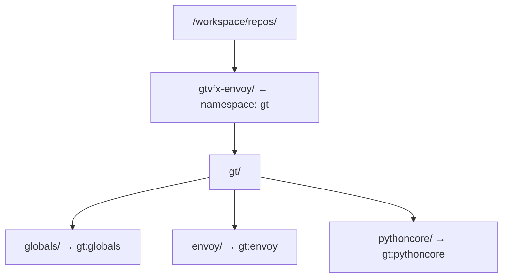

# Core Concepts

## Bundles

A **bundle** is a Git repository containing an `.envoy/` directory. Each bundle can define commands and environment files.

```
my-bundle/
├── .git/
├── .envoy/
│   ├── commands.json       ← command definitions
│   ├── global_env.json     ← loaded before every command's env files
│   └── tool_env.json       ← per-tool environment
└── src/
```

Bundles are the unit of distribution in the envoy ecosystem. A developer checks out one or more bundles under a shared root, and envoy discovers all of them automatically via `ENVOY_BNDL_ROOTS`.

### Bundle ID (bndlid)

Each bundle has a **bundle ID** (`bndlid`) of the form `<namespace>:<name>`. A published bundle states its ID in its [`.bundle` marker](bundle-discovery.md#the-bundle-marker-file). A checkout has no marker, so its name is its directory name and its namespace is inferred from the parent directory name:



The default namespace is `gt`. It applies when the parent directory does not look like a namespace, and to a published bundle whose marker names it without a namespace. It can be overridden via the Python API.

## Commands

Commands are defined in `.envoy/commands.json`:

```json
{
    "python": {
        "environment": ["python_env.json"],
        "alias": ["python", "-X", "dev"]
    },
    "unreal": {
        "environment": ["unreal_env.json"]
    },
    "build": {
        "environment": ["build_env.json"],
        "alias": ["make", "build"]
    }
}
```

| Field | Required | Description |
|---|---|---|
| `environment` | Yes | List of env JSON files to load (relative to `.envoy/`) |
| `alias` | No | Executable + base args. `alias[0]` is the exe; `alias[1:]` are prepended args. If omitted, the command name is used as the executable. |

### Platform Overrides

A single command definition can describe Windows, Linux, and macOS behavior.
The base `environment` and `alias` work on every platform unless an override
replaces them. Resolution is deterministic:

1. Base command definition
2. Current operating-system override
3. Current CPU architecture override

Supported operating-system keys are `windows`, `linux`, and `macos`.
Supported architecture keys are `x86_64` and `aarch64`. Each override replaces
only the fields it contains, so the other effective fields remain inherited.

```json
{
    "tool": {
        "environment": ["tool_env.json"],
        "alias": ["tool"],
        "platforms": {
            "windows": {
                "alias": ["tool.exe"]
            },
            "macos": {
                "architectures": {
                    "aarch64": {
                        "environment": [
                            "tool_env.json",
                            "tool_apple_silicon_env.json"
                        ]
                    }
                }
            }
        }
    }
}
```

Use `envoy --info tool` to see the current target and applied override chain.
`envoy --diagnose tool` includes the same information with the resolved
environment.

### Running Commands

```console
en python script.py --arg value
en unreal MyGame.uproject
en build --target Release
```

Anything after the command name is passed through verbatim to the child process.

## Environment Files

Environment files are JSON files that define variable assignments. They use **operator prefixes** on keys to control how values are applied:

| Key syntax | Effect |
|---|---|
| `"VAR": "value"` | Assign / replace |
| `"+=VAR": "value"` | Append to existing, separated by the OS path separator |
| `"^=VAR": "value"` | Prepend to existing, separated by the OS path separator |
| `"?=VAR": "value"` | Set only if `VAR` is not already defined (default / fallback) |

**List values** — A JSON array is joined with the OS path separator:

```json
{
    "PYTHONPATH": [
        "${__BUNDLE__}/py",
        "${__BUNDLE__}/vendor"
    ]
}
```

**Variable expansion** — Use `${VARNAME}` to reference variables already in scope:

```json
{
    "APP_ROOT": "${__BUNDLE__}",
    "APP_CONFIG": "${APP_ROOT}/config/dev.json",
    "+=PYTHONPATH": "${__BUNDLE__}/src"
}
```

See [Environment Files](env-files.md) for the full reference.

## Team Configuration

A bundle may define `.envoy/team.json` with team-scoped settings — production
bundle and stack roots, plus an optional per-user/host config file path:

```json
{
    "name": "bfd",
    "prodBundlesRoot": "/studio/bundles",
    "prodStacksRoot": "/studio/stacks"
}
```

Envoy discovers and resolves the first `team.json` found across discovered bundles automatically — see it with `envoy --diagnose`, or from Python via `envoy.getCurrentTeamConfig()`.

## Stacks

A Stack is a strict YAML `.estack` file describing one isolated, ordered
runtime bundle collection. Select one directly with `--stack`, `ENVOY_STACK`,
or the `stack` user setting. Its name is derived from its filename stem.

Named, versioned stacks live under `ENVOY_STACK_ROOTS`. When
`ENVOY_STACK_CONTEXT=team:project:feature` is set, envoy tries stack
namespaces in this order: `team:project:feature`, `team:project`, `team`, and
finally `gt`. Multiple stacks at the same matching level are an error.

```yaml
namespace: team:project
metadata:
  owner: build-tools
bundles:
  - path: ${STUDIO_ROOT}/bundles/gt/pythoncore
    metadata:
      role: core
```

See the selected stack with `envoy --diagnose`, or from Python via
`envoy.getCurrentStack()`.

## Bundle Cache

Envoy copies the **published** bundles a command uses to a local cache the first time it needs them, then runs from that copy, so a slow or unreachable network share stops mattering. Your own checkout (a bundle without a `.bundle` marker) is never cached. Only a command that is about to run copies anything; listing and inspecting read from the share.

The cache lives in `~/.envoy/cache` by default. See [Bundle Caching](caching.md) for how it works, how to configure it, and how it cleans up after itself, or run `envoy --diagnose` to see its current status.

## VCS Integration

`envoy.Vcs.detect()` (Python) or `envoy --diagnose` (CLI) auto-detects the current working copy's version control backend — Git, Perforce, or [Lore](https://github.com/EpicGames/lore) — and reports pending changes through a single, normalized interface, regardless of which backend is in use. Set `ENVOY_VCS` to force a specific backend.
