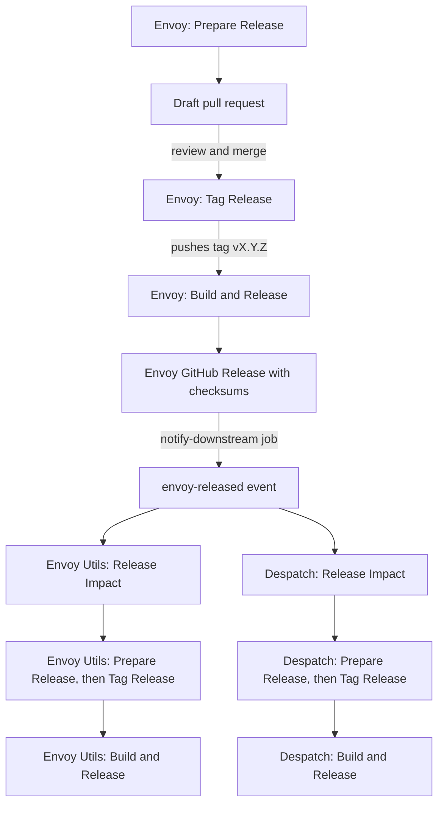
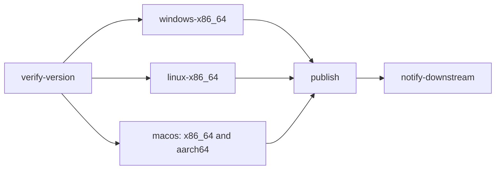

# Build and Release Chain

This page explains what happens automatically between "a maintainer starts a
release" and "users can download it", for all three projects. For the
step-by-step procedure see [Releasing](releasing.md). For failed runs see
[Release Troubleshooting](release-troubleshooting.md).

The chain is also called the *release train*: Envoy releases first, and the two
projects built on top of it are assessed and released afterwards.

## The three projects

| Project | Repository | Produces | Depends on |
|---|---|---|---|
| Envoy | `gtvfx-envoy/envoy` | Native `envoy` CLI archives (Windows, Linux, macOS Intel, macOS Apple silicon), Python wheels, and `SHA256SUMS`. | Nothing in this chain. |
| Envoy Utils | `gtvfx-envoy/envoy_utils` | `engit` CLI archives for the same platforms, `compatibility.json`, and `SHA256SUMS`. | Statically links `envoy-core` from an Envoy Git tag. `rust/Cargo.toml` pins it by tag **and** exact crate version. |
| Despatch | `gtvfx-envoy/despatch` | A standalone executable for Windows, plus Linux and macOS builds. | Embeds a *published* Envoy release (wheel and CLI archive downloaded from the Envoy GitHub Release) at build time. |

Order matters. Envoy Utils and Despatch both consume a **published** Envoy
release, so Envoy must finish first. After that the two do not depend on each
other and can proceed in parallel.

## The chain at a glance



People start only the boxes labelled *Prepare Release* and *Tag Release*. Every
other box is triggered by the one before it. The *Release Impact* workflows only
**assess** whether a downstream project needs a release. A maintainer decides
(or, optionally, auto-cascade starts the downstream Prepare Release for you).
[Releasing](releasing.md) explains the decision rules.

## Envoy

### Before the tag build: Prepare Release and Tag Release

Both are manual workflows (**Actions > Run workflow**, or `gh workflow run`)
that run on GitHub-hosted runners and use the `gt-release-automation` GitHub App.

- **Prepare Release** opens (or updates) a *draft* pull request on
  `automation/release-vX.Y.Z`. It bumps the Cargo workspace version, refreshes
  `Cargo.lock`, and runs the release-readiness checks. You review and merge it
  like any other pull request.
- **Tag Release** refuses to continue unless `main` already contains the
  expected version, the checked-out commit is the current tip of `origin/main`,
  `lint.yml` passed on that exact commit, and neither the tag nor a GitHub
  Release exists yet. It then pushes the annotated tag `vX.Y.Z` using the App
  token. Pushing with the App token (rather than the default `GITHUB_TOKEN`) is
  what makes the push start the next workflow.

### What a tag build does

The **Build & Release** workflow (`.github/workflows/build-release.yml`) starts
when a tag matching `v*` is pushed. It can also be started by hand as a
[validation build](#validation-builds).



| Job | Runs on | What it does |
|---|---|---|
| `verify-version` | GitHub-hosted `ubuntu-24.04` | Fails fast if the tag does not match the Cargo workspace version. |
| `windows-x86_64` | Self-hosted Windows | Tests, builds the CLI and wheel, and packages a ZIP. |
| `linux-x86_64` | GitHub-hosted `ubuntu-24.04` | Builds a static musl CLI with `cross`, builds a manylinux2014 wheel, and packages a `tar.gz`. |
| `macos` | GitHub-hosted `macos-15-intel` and `macos-15` | Tests, builds the CLI and wheel, and packages a `tar.gz` per architecture. |
| `publish` | GitHub-hosted `ubuntu-24.04` | Collects every artifact, writes `SHA256SUMS`, and creates the GitHub Release. Tag pushes only. |
| `notify-downstream` | GitHub-hosted `ubuntu-24.04` | Tells Envoy Utils and Despatch about the release. Runs only when the `RELEASE_AUTOMATION_ENABLED` variable is `true`. |

A platform job starts only after `verify-version` passes, and `publish` starts
only after **all three** platform jobs pass. One failed platform therefore means
**nothing is published**.

#### verify-version

Runs `python scripts/release_automation.py check --expect-version X.Y.Z` (the
tag without its `v`). The script checks that:

1. the version is valid SemVer;
2. `[workspace.package].version` in `rust/Cargo.toml` equals it;
3. `Cargo.lock` lists `envoy-cli`, `envoy-core`, and `envoy-py`, each with the
   same version.

Tag Release already enforces this, but a tag pushed by hand skips Tag Release.
Without this job, a mismatched tag would still build and publish archives named
`vX.Y.Z` from a commit whose crate version says something else, and Envoy Utils
could not pin it (see
[Versions](#versions-where-they-live-and-what-must-agree)).

A failure looks like this:

```text
release_automation.py: error: Expected Envoy 0.7.0, but the workspace is 0.6.2.
```

On validation builds the script runs without `--expect-version`, because the
version label there is arbitrary. It then only checks that the manifest and
lockfile agree with each other.

#### windows-x86_64

Runs on the self-hosted Windows runner. In order, it:

1. checks out the repository with full history and sets up Python 3.11;
2. confirms Git Bash is installed and puts it on `PATH` (the Rust toolchain
   action needs it) and installs the stable Rust toolchain;
3. runs `cargo test --workspace --exclude envoy-py`, the native workspace tests.
   `envoy-py` is excluded because it links against a Python interpreter (PyO3)
   and is built and tested through `maturin` instead;
4. runs `cargo test -p envoy-py --lib`, the Rust unit tests of the Python
   bindings;
5. runs `python scripts/build_native.py --skip-wheel` to build the release CLI;
6. builds the wheel with `maturin`, installs it from `dist/` (offline, with
   `--no-index --find-links dist`), and runs `pytest rust/envoy-py/tests`. This
   proves the *built wheel* works, not merely that it compiled;
7. runs `envoy.exe --version` as a smoke test;
8. packages `envoy-vX.Y.Z-windows-x86_64.zip` with `scripts/package_release.py`
   and uploads it, plus the wheel, as workflow artifacts.

#### linux-x86_64

Runs on a GitHub-hosted `ubuntu-24.04` runner because it **needs Docker**: both
the static CLI build and the wheel build run compilers inside containers. In
order, it:

1. checks out the repository, sets up Python 3.11, installs Rust with the
   `x86_64-unknown-linux-musl` target, and restores the Cargo cache;
2. installs `cross` at a pinned version (`0.2.5`) so a new `cross` release
   cannot change the build unnoticed;
3. runs `cross test` and `cross build --release` for the musl target (again
   excluding `envoy-py`). `cross` runs `cargo` in a container that has the musl
   toolchain, producing a **static** executable that runs on any distribution;
4. verifies the result: `envoy --version` runs, and `file` reports the binary as
   statically linked;
5. builds a **manylinux2014** wheel with `PyO3/maturin-action`. The action runs
   `maturin` inside the `quay.io/pypa/manylinux2014_x86_64` container, whose old
   glibc lets the wheel install on older distributions. It uses its own Cargo
   target directory (`rust/target-manylinux2014`) so container build products
   never mix with the musl build;
6. restores file ownership. The container runs as `root`, so `dist/` and the
   manylinux target directory end up root-owned. A short second container runs
   `chown -R` to hand them back to the runner user so later steps can use them;
7. installs the wheel on the host and runs `pytest rust/envoy-py/tests`;
8. packages `envoy-vX.Y.Z-linux-x86_64-musl.tar.gz` and uploads it, plus the
   wheel.

!!! warning "This job needs a container engine"
    `cross` and the manylinux build fail on any runner without Docker. The
    self-hosted Linux runner does not provide it, which is why this job is
    pinned to a GitHub-hosted runner. See [CI Runners](ci-runners.md).

#### macos

Runs twice, on `macos-15-intel` (x86_64) and `macos-15` (aarch64), both
GitHub-hosted. The steps match the Windows job without the Git Bash step.
Packages are `envoy-vX.Y.Z-macos-x86_64.tar.gz` and
`envoy-vX.Y.Z-macos-aarch64.tar.gz`. Binaries are currently **unsigned**; a
placeholder in the workflow marks where signing and notarization will go.

#### publish

Runs only on tag pushes. It downloads every `release-*` artifact into `dist/`,
writes `SHA256SUMS` over all of them, and creates the GitHub Release with
`softprops/action-gh-release`. If a release for the tag already exists, that
action **updates it** instead, replacing its body, so never create the release
by hand (see [Release Troubleshooting](release-troubleshooting.md)).
`fail_on_unmatched_files` makes the step fail if an expected file pattern
matches nothing.

#### notify-downstream

Runs only after `publish`, and only when the `RELEASE_AUTOMATION_ENABLED`
repository variable is `true`. It mints an App token and sends a
`repository_dispatch` event named `envoy-released` to `envoy_utils` and
`despatch`. The payload carries:

| Field | Example |
|---|---|
| `schema_version` | `1` |
| `envoy_tag` | `v0.7.1` |
| `envoy_version` | `0.7.1` |
| `envoy_commit` | the tagged commit's SHA |
| `release_url` | the GitHub Release page |

Each receiver re-checks the event against the real GitHub Release before doing
anything: the Envoy tag must have a published release, the schema version must
be `1`, and the commit at that tag must equal `envoy_commit`.

### Release artifacts

A complete Envoy release has exactly nine assets:

| Asset | What it is |
|---|---|
| `envoy-vX.Y.Z-windows-x86_64.zip` | Windows bundle. |
| `envoy-vX.Y.Z-linux-x86_64-musl.tar.gz` | Static Linux bundle. |
| `envoy-vX.Y.Z-macos-x86_64.tar.gz` | macOS Intel bundle. |
| `envoy-vX.Y.Z-macos-aarch64.tar.gz` | macOS Apple silicon bundle. |
| `envoy-0.0.0-cp310-abi3-win_amd64.whl` | Python wheel for Windows. |
| `envoy-0.0.0-cp310-abi3-manylinux_2_17_x86_64.manylinux2014_x86_64.whl` | Python wheel for Linux. |
| `envoy-0.0.0-cp310-abi3-macosx_10_12_x86_64.whl` | Python wheel for macOS Intel. |
| `envoy-0.0.0-cp310-abi3-macosx_11_0_arm64.whl` | Python wheel for macOS Apple silicon. |
| `SHA256SUMS` | SHA-256 checksum of every other asset. |

Each bundle unpacks to `gt/envoy/vX.Y.Z/` containing `bin/` (the `envoy`
executable and the `en` alias), `.envoy/`, a `.bundle` marker, the license, and
the README. The wheel version `0.0.0` is a deliberate placeholder, and
`cp310-abi3` means one wheel serves CPython 3.10 and newer.

Verify a release after it publishes:

```powershell
gh release view vX.Y.Z --repo gtvfx-envoy/envoy --json assets --jq '.assets[].name'
```

You should see all nine names. Despatch's installer requires exactly one wheel
for its platform, one platform archive, and `SHA256SUMS`, so a missing asset
shows up there as `Expected one ... found 0`.

### Versions: where they live and what must agree

| Where | Example | Notes |
|---|---|---|
| `[workspace.package].version` in `rust/Cargo.toml` | `0.7.1` | Source of truth. Changed by Prepare Release. |
| `envoy-cli`, `envoy-core`, `envoy-py` in `rust/Cargo.lock` | `0.7.1` | Regenerated by Cargo. Must match the manifest. |
| Git tag | `v0.7.1` | Created by Tag Release. Names the build. |
| Archive file names and the `.bundle` marker | `envoy-v0.7.1-...` | Taken from the tag string. |
| `envoy --version` output | `v0.7.1` | Derived at build time from `git describe --tags`. It falls back to the Cargo version when git cannot describe the checkout, so it can look correct even when the Cargo version is wrong. |
| Wheel version | `0.0.0` | Placeholder by design. |
| Envoy Utils pin | `tag = "v0.7.1", version = "=0.7.1"` | Cargo refuses to resolve the pin if the tagged crate has a different version. |
| Despatch embedded Envoy | `ENVOY_RELEASE` defaults in its release workflows | Updated by Despatch Prepare Release. |

The first three must agree. If they do not, everything downstream breaks in
confusing ways. For example, Envoy Utils reports
`candidate versions found which didn't match: 0.6.2` when it pins a tag whose
crate version was never bumped. Tag Release and `verify-version` both enforce
the rule.

### Validation builds

A validation build runs the same jobs as a tag build but skips `publish` and
`notify-downstream`, so it can never create a release. Run one after you change
a workflow, after any runner change, and before the first release after a long
gap:

```powershell
gh workflow run "Build & Release" --repo gtvfx-envoy/envoy --ref main -f version=dev
gh run watch --repo gtvfx-envoy/envoy
```

- `--ref` may name a branch, in which case that branch's copy of the workflow
  runs. Use this to test a workflow change before merging it.
- `version` is only a label (`dev` by default). Artifacts are named from it and
  stay downloadable from the run page.
- Envoy Utils has the same `version` input. Despatch instead takes
  `envoy_version`, the published Envoy version to embed, and that Envoy release
  must already exist.

## Envoy Utils

The Envoy Utils workflows described below run on GitHub-hosted runners. Its
documentation deployment runs on the self-hosted Linux runner described in
[CI Runners](ci-runners.md).

| Workflow | Starts when | What it does |
|---|---|---|
| Prepare Release | Manual (`version`, `envoy_version`) | Updates the workspace version, rewrites the Envoy Core pin (tag and exact version together), runs `cargo update -p envoy-core`, validates the lockfile, and opens a draft pull request. |
| Tag Release | Manual | Same validations as Envoy's, then pushes the annotated tag with the App token. |
| Build & Release | Tag push, or manual validation build | Builds Windows (`windows-2025`), Linux (static, with `cross`), and macOS (two architectures). `publish` then adds `compatibility.json` and `SHA256SUMS`, creates the release, and closes the matching impact issue. |
| Envoy Release Impact | `envoy-released` event, or manual replay with `envoy_version` | `classify` checks the Envoy release exists and classifies the changed files. `compatibility` tests Envoy Utils against the candidate on Linux and Windows. `notify` creates or updates an issue labelled `dependency:envoy-core` and `release-impact:review` or `release-impact:required`. |

## Despatch

| Workflow | Runs on | Starts when | What it does |
|---|---|---|---|
| Prepare Release | Self-hosted Windows | Manual (`version`, `envoy_version`) | Installs the requested Envoy release, syncs the Despatch version and the Envoy pin, runs tests, Ruff, and format checks, and opens a draft pull request. |
| Tag Release | GitHub-hosted | Manual | Same validations, then pushes the annotated tag. |
| Build & Release | Self-hosted Windows plus GitHub-hosted Linux and macOS | Tag push, or manual validation build (`envoy_version`) | Builds, smoke-tests, and uploads the executable on each platform. |
| Envoy Release Impact | GitHub-hosted, plus self-hosted Windows for `validate` | `envoy-released` event, or manual replay | `classify` as for Envoy Utils. `validate` runs the source tests and builds and checks the final windowed executable. `notify` creates or updates the issue. |

Two Despatch details matter when you manage a release:

- The Windows jobs need the studio bundle share configured by the
  `ENVOY_STUDIO_BNDLS` Actions variable to be reachable from the Windows runner.
  See [CI Runners](ci-runners.md#what-a-self-hosted-runner-must-provide).
- Each platform job uploads its own asset to the GitHub Release as soon as it
  succeeds. There is no all-or-nothing gate like Envoy's `publish`, so one
  failed job can leave a release with only some of its three assets (Windows
  `despatch.exe`, Linux `despatch-vX.Y.Z-linux-x64`, macOS
  `despatch-vX.Y.Z-macos.zip`). Always confirm all three are present.
