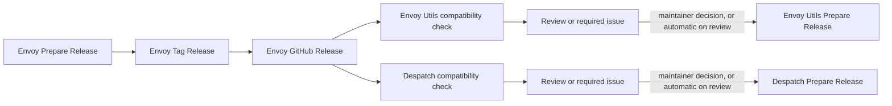

# Releasing Envoy, Envoy Utils, and Despatch

The three projects are independently versioned. Envoy releases are assessed
automatically against Envoy Utils and Despatch, but maintainers decide whether
a passing downstream project needs to be repinned and released.

This page is the step-by-step procedure. [Build and Release Chain](build-chain.md)
explains what the workflows do, [CI Runners](ci-runners.md) covers where they
run, and [Release Troubleshooting](release-troubleshooting.md) covers failed
runs.



## One-time organization setup

Create and install an organization GitHub App named
`envoy-release-automation` on `envoy`, `envoy_utils`, and `despatch`.
Grant these repository permissions:

- Metadata: read
- Contents: read and write
- Pull requests: read and write
- Issues: read and write

Store the credentials as organization Actions secrets, restricted to those
three repositories:

- `RELEASE_AUTOMATION_APP_ID`
- `RELEASE_AUTOMATION_PRIVATE_KEY`

Allow GitHub Actions to create pull requests in the organization or in each
repository's **Actions > General > Workflow permissions** settings.

If an Actions policy (**Settings > Actions > Policies**) limits who can trigger
workflows, add the App's installation to its allowed actors with the actor type
`IntegrationInstallation`. Without it, every run the App starts fails
immediately with `startup_failure`: the tag build, the downstream impact
workflows, and the checks on Prepare Release pull requests. In this
organization an entry of type `App` did not match, while
`IntegrationInstallation` did. See
[Runs that never start](release-troubleshooting.md#runs-that-never-start-startup_failure).

Set the `RELEASE_AUTOMATION_ENABLED` repository variable to `true` in Envoy
after the App is installed everywhere. Until then, Envoy releases still build
normally but do not dispatch downstream assessments.

The App token is used only in trusted manual and release workflows. Pull
request compatibility checks use read-only repository credentials.

Optionally set the `RELEASE_AUTOMATION_AUTO_PREPARE` repository variable to
`true` in Envoy Utils and/or Despatch to let a `review`-classified impact run
automatically dispatch that repository's own Prepare Release workflow (see
"Review downstream impact" below). This uses each workflow's own
`GITHUB_TOKEN` with an `actions: write` permission -- dispatching a
repository's own `workflow_dispatch` event is exempt from the usual token
recursive-trigger restriction, so no additional App permission is needed for
this. Leave it unset (the default) to keep downstream release preparation
manually triggered.

**Do not enable `RELEASE_AUTOMATION_AUTO_PREPARE` until Envoy Utils has
published a release that provides `engit release-train`.** Envoy Utils'
own impact workflow is unaffected (it builds `engit` from source in the
same run), but Despatch's equivalent workflow downloads a released `engit`
and requires the `ENGIT_RELEASE_TRAIN_VERSION` repository variable to be
set to that release's version first -- it fails fast with an explicit error
if enabled before that variable is set, rather than failing cryptically
partway through.

## Release and compatibility states

Automated downstream checks use three states:

- `none`: no relevant downstream contract changed.
- `review`: relevant code changed and the current downstream source passes
  against it. A maintainer must decide whether users need a newly linked or
  embedded runtime.
- `required`: the current downstream source fails to compile, test, package,
  or pass its runtime checks with the Envoy candidate.

`required` means a compatibility check failed. It does not say why. Envoy Utils
saves only the process exit code, while Despatch saves only per-step outcomes;
neither captures the error text. Read the failing step's log before you change
code; see
[A `required` result: check the cause](release-troubleshooting.md#a-required-result-check-the-cause).

Envoy Utils is tested against candidate Envoy Core on Linux and Windows.
Despatch is tested on Windows against the released Envoy wheel, including its
source tests, Ruff checks, PyInstaller build, final executable, bundled docs,
and frozen launch worker.

These checks can prove that a release is required when compatibility fails.
They cannot prove that a release is unnecessary when tests pass: a release may
still be needed to deliver new statically linked or embedded behavior.

## Standard release sequence

All operator-provided version inputs are unprefixed SemVer values such as
`0.6.0`. Automation adds the `v` prefix when it addresses Git tags. A release is
`X.Y.Z`; its pre-releases are `X.Y.Z-alpha.N` and `X.Y.Z-rc.N`.

### Versions, pre-releases, and what a build reports

The version in `rust/Cargo.toml` is the *target*: the version the work on `main`
is heading for. It is set with **Prepare Release** and merged like any other
change, before any tag exists, so a build of `main` says what it is part of
instead of what came before it.

| Stage | Versions | Meaning |
|---|---|---|
| Alpha | `0.8.0-alpha.1`, `0.8.0-alpha.2`, ... | Work toward 0.8.0 is under way. Declare `0.8.0-alpha.1` right after 0.7.0 is released. |
| Release candidate | `0.8.0-rc.1`, `0.8.0-rc.2`, ... | Feature complete and being tested. |
| Release | `0.8.0` | |

They sort in that order, and the number is dotted so that `rc.2` sorts before
`rc.10`. No other stage is accepted, and a release version never carries build
metadata. Merging a Prepare Release pull request declares a target without
tagging anything; **Tag Release** is what publishes one.

What a build reports (`envoy --version`, `envoy-shim --envoy-shim-version`, and
`envoy.__version__`) is the Cargo version with a leading `v`. A build from the
commit tagged with that version reports exactly it, `v0.8.0-rc.1`. Any other
build adds the commit it was built from after a `+`, as in
`v0.8.0-rc.1+g8ec805c`, and `.dirty` after that when tracked files have
uncommitted changes. Build metadata never changes how versions order, so that is
a 0.8.0-rc.1 build, neither older nor newer than the candidate. The wheel takes
the same version, written for Python as `0.8.0rc1`.

Packaging holds a tagged build to this: `scripts/package_release.py` and
`scripts/package_shim.py` run the built executable and refuse to package it as
`v0.8.0-rc.1` when it says anything else. A build labelled with something that is
not a version, such as the `dev` of a validation build, is not held to it. To
test a candidate before tagging it, label the validation build with the version
it is for (`-f version=v0.8.0-rc.1`), so the archive names, the `.bundle` marker,
and the executable agree. The [launcher](../launcher.md) says so, once, when it
copies an app that reports another version than the one it was published as.

### Which repository, and which version?

Each project has its own **Prepare Release** and **Tag Release** workflows and
its own version number. Run each workflow in the repository that owns the
version you are entering. An Envoy version such as `0.7.0` is not valid input
for Envoy Utils or Despatch; their workflows expect their own versions.

| Step | Repository | Workflow | Inputs |
|---|---|---|---|
| 1 | `envoy` | Prepare Release | `version`: the new Envoy version, for example `0.7.0`. |
| 2 | `envoy` | *Merge the draft pull request.* | |
| 3 | `envoy` | Tag Release | `version`: the same Envoy version, `0.7.0`. |
| 4 | `envoy` | *Automatic:* Build & Release, publish, notify. | |
| 5 | `envoy_utils` | Prepare Release | `version`: the **Envoy Utils** version, for example `0.2.2`. `envoy_version`: the published Envoy version, `0.7.0`. |
| 6 | `envoy_utils` | Tag Release, after merging that pull request | `version`: the Envoy Utils version, `0.2.2`. |
| 7 | `despatch` | Prepare Release | `version`: the **Despatch** version. `envoy_version`: the published Envoy version, `0.7.0`. |
| 8 | `despatch` | Tag Release, after merging that pull request | `version`: the Despatch version. |

Steps 5 to 8 apply only when the impact assessment says a downstream release is
needed, and Envoy Utils and Despatch can proceed in parallel. Tag Release never
needs a tag created beforehand: it creates the tag itself and fails if the tag
already exists. If it fails with `Expected Envoy Utils X, found Y` (or the
Despatch or Envoy equivalent), you entered another project's version, ran it in
the wrong repository, or have not merged the Prepare Release pull request yet.

### Local validation before tagging

The release workflows repeat these checks in CI, but running them locally makes
failures easier to diagnose before creating a tag.

Iterating on an Envoy change and want to test it against Envoy Utils or
Despatch before it is even committed, let alone tagged? From an `envoy_utils`
checkout, `engit dev link rust <path-to-envoy-checkout>` points the
`envoy-core` Cargo dependency at that local checkout (reversible with
`engit dev unlink rust`); `engit dev link python <path-to-envoy-checkout>`
builds an isolated dev bundle for Envoy's Python API. If Despatch has an
Envoy Stack active, add the printed bundle path directly to it -- Envoy
resolves bundles from the active Stack and does not consult
`ENVOY_BNDL_ROOTS` while one is set; otherwise add its parent directory to
`ENVOY_BNDL_ROOTS` (or reference the bundle directly). Never commit a
workspace in a dev-linked state -- `lint.yml` fails fast if
`rust/Cargo.toml` is left pointing at a local path.

For Envoy Utils, run the preparation command from the `envoy_utils` checkout.
It updates the workspace version, sets the Envoy Core tag and exact crate
version, regenerates `Cargo.lock`, and runs a workspace build check:

```powershell
python scripts/release_automation.py prepare `
    --version 0.2.0 `
    --envoy-version 0.6.0
```

Then run the validator explicitly:

```powershell
python scripts/release_automation.py check `
    --expect-version 0.2.0 `
    --expect-envoy-version 0.6.0
```

`Cargo.toml` is the source declaration. It should name the Envoy repository,
its `v<version>` tag, and the matching exact crate version. `Cargo.lock` is the
Cargo-generated resolution and records the exact commit behind that tag. Do
not replace the tag URL with a GitHub `/commit/<hash>` URL or hand-edit the
lockfile. A valid lockfile source looks like:

```text
git+https://github.com/gtvfx-envoy/envoy?tag=v0.6.0#<commit>
```

The Envoy Utils release version and Envoy Core dependency version are
independent. For example, Envoy Utils `0.2.0` can be paired with Envoy Core
`v0.6.0`.

For Despatch, run its repository-local preparation workflow with the new
Despatch version and Envoy version, then run the repository's lint, test, and
executable-build checks before tagging. The release workflow performs the same
checks on Windows and uploads the executable only after a successful build.

### Rehearse the tag build

A tag build runs on three operating systems, on both GitHub-hosted and
self-hosted runners. If a workflow, a runner, or anything the release jobs
depend on has changed since the last release, rehearse it first. A validation
build runs the same jobs as a tag build but never publishes:

```powershell
gh workflow run "Build & Release" --repo gtvfx-envoy/envoy --ref main -f version=dev
gh run watch --repo gtvfx-envoy/envoy
```

Every platform job must pass. Use `--ref <branch>` to rehearse a workflow change
before merging it. See [Validation builds](build-chain.md#validation-builds).

### 1. Prepare Envoy

Run **Prepare Release** in `envoy` with the new version. It opens or updates
a draft pull request on `automation/release-v<version>` that:

- updates `[workspace.package].version` in `rust/Cargo.toml`;
- refreshes and validates the workspace entries in `rust/Cargo.lock`;
- runs the release-readiness tests.

The Envoy pull request also runs an advisory Envoy Utils compatibility check
when Envoy Core source or dependencies change. A failure is reported as a
warning and evidence artifact; it does not block an intentional Envoy API
change from merging.

Review and merge the preparation pull request through the normal process.

### 2. Tag and publish Envoy

Run **Tag Release** in `envoy` with the same version. It verifies that:

- `main` contains the expected Cargo and lockfile version;
- the checkout matches `origin/main`;
- the exact `main` commit passed `lint.yml`;
- the tag and GitHub Release do not already exist.

The workflow pushes an annotated `v<version>` tag through the GitHub App. The
existing **Build & Release** workflow first verifies that the tag matches the
Cargo workspace version, then builds and tests all platforms, creates checksums,
and publishes the GitHub Release. Confirm the release has all thirteen expected
assets (see [Release artifacts](build-chain.md#release-artifacts)).

!!! warning "Do not create the tag or the GitHub Release by hand"
    **Tag Release** is the only supported way to create a release tag. It checks
    that the version was prepared and merged, that `lint.yml` passed on the exact
    commit, and that nothing exists yet for the version. **Build & Release** then
    creates the GitHub Release itself, but only after every platform has built. A
    release created by hand is public immediately, before any build has run, and
    shows as the repository's *latest* release with no assets. Envoy Utils and
    Despatch cannot use such a release.

!!! note "The tag build starts by itself"
    Do not start **Build & Release** yourself after Tag Release. Pushing the tag
    starts it within seconds. Look for a **Build & Release** run on the tag, with
    the event `push`, in the **Actions** tab. The **Run workflow** button on that
    workflow is only for [validation builds](build-chain.md#validation-builds):
    its *Version label* is just a name for the artifacts (leave it as `dev`), and
    a validation build never publishes. If the run on the tag shows
    `startup_failure` instead, see
    [Runs that never start](release-troubleshooting.md#runs-that-never-start-startup_failure).

After publication, Envoy immediately dispatches an `envoy-released` event to
Envoy Utils and Despatch. Each repository validates the event against the
actual GitHub Release before acting. A pre-release (`0.8.0-alpha.N` or
`0.8.0-rc.N`) is published as a GitHub pre-release and is not announced: the
downstream repositories hear only about stable releases. To check a candidate
against one of them anyway, replay the event by hand (see
[Manual replay and failures](#manual-replay-and-failures)).

### 3. Review downstream impact

Relevant releases create or update one issue per Envoy tag in each downstream
repository. The issue contains changed files, API usage, test evidence, and a
maintainer checklist. Duplicate or manually replayed events update the same
issue.

For `none`, the Actions summary records the decision and no issue is created.
For `review`, choose whether the new linked or embedded behavior is useful to
consumers. For `required`, update the downstream source as necessary before
preparing its release.

When a repository's `RELEASE_AUTOMATION_AUTO_PREPARE` variable is `true`
(see "One-time organization setup" above), a `review` classification also
automatically dispatches that repository's own step 4 or 5 Prepare Release
below, using a patch-bumped version and the new Envoy pin, and comments on
the tracked issue noting it. This only ever triggers the same, unmodified
workflow described below: it still runs full validation and opens a draft
pull request for the normal review-and-merge process below. `required`
classifications are never auto-dispatched. Leave the variable unset (the
default) to keep downstream release preparation manually triggered.

Either way, the same computation is available on demand from any `envoy_utils`
checkout: `engit release-train prepare-downstream --repo <envoy_utils|despatch>
--envoy-version <version>` (add `--dry-run` to preview the resulting `gh`
invocation without dispatching anything). `engit release-train status` prints
each repository's latest release and open impact issues in one place.

Envoy Utils and Despatch do not depend on each other and may proceed in
parallel.

### 4. Prepare and publish Envoy Utils when needed

Run **Prepare Release** in `envoy_utils` with:

- its new version; and
- the already-published Envoy version.

The generated pull request updates the Envoy Utils workspace version, changes
the Envoy Core Git tag and exact crate version together, runs
`cargo update -p envoy-core`, and validates the resolved commit in
`Cargo.lock`. Never edit the Git commit in `Cargo.lock` manually.

After the pull request passes and is merged, run **Tag Release** with the Envoy
Utils version. Its release body is the canonical compatibility record and
contains the Envoy Utils-to-Envoy Core pairing and pinned Envoy commit. The
release also attaches `compatibility.json`, covered by `SHA256SUMS`.

Publishing the release automatically closes its matching Envoy-impact issue.

### 5. Prepare and publish Despatch when needed

Run **Prepare Release** in `despatch` with its new version and the Envoy version
to embed. The pull request synchronizes `pyproject.toml`,
`py/despatch/__init__.py`, and both Envoy defaults in the executable release
workflow.

After review and merge, run **Tag Release** with the Despatch version. Its
existing tag build downloads exactly one compatible Windows ABI3 Envoy wheel,
builds the final windowed executable, runs its runtime smoke tests, and uploads
it to the GitHub Release. Publication closes the matching impact issue. Each
platform job uploads its own asset as soon as it succeeds, so confirm that the
Windows, Linux, and macOS assets are all on the release.

## Envoy Utils compatibility records

Do not maintain a compatibility matrix in the Envoy Utils README or docs home
page. Each GitHub Release is authoritative because patch releases within one
series may use different Envoy Core versions.

The `compatibility.json` schema is:

```json
{
  "schema_version": 1,
  "envoy_utils": {
    "version": "0.2.0",
    "tag": "v0.2.0",
    "commit": "<commit>"
  },
  "envoy_core": {
    "version": "0.6.0",
    "tag": "v0.6.0",
    "commit": "<commit>"
  }
}
```

Run **Backfill Release Compatibility** once in Envoy Utils for `0.1.0`. It
derives the existing `v0.1.0` to Envoy `v0.5.1` pairing from that tag's Cargo
manifest and lockfile, preserves the existing assets, adds
`compatibility.json`, updates the release body, and regenerates `SHA256SUMS`
over the complete asset set. Run this backfill before merging removal of the
old README and docs tables.

## Manual replay and failures

Both downstream **Envoy Release Impact** workflows accept an unprefixed Envoy
version for replay after a runner or external service failure.

- A failed preparation workflow changes no release state; fix the cause and
  rerun it. The existing automation branch and draft pull request are updated.
- A failed tag build normally does not publish a release because publication depends on
  every platform build. A later bookkeeping or issue-closing step can still fail
  after publication, so check the GitHub Release and its assets before rerunning.
- A re-run uses the workflow files from the tagged commit. Re-run only when the
  cause is outside the repository, such as software missing on a runner. If the
  fix changes a file, release the next patch version instead. See
  [Re-run or fix forward](release-troubleshooting.md#re-run-or-fix-forward).
- A run that ends in `startup_failure` has no jobs and cannot be re-run. See
  [Runs that never start](release-troubleshooting.md#runs-that-never-start-startup_failure).
- Do not move or reuse a published tag. Fix forward with a new patch release. A
  tag that has been pushed counts as published, even when its build failed or
  its release page is empty. The one narrow exception is re-pushing the
  *identical* tag object when the first push never started a build; the
  troubleshooting guide describes it.
- If an Envoy release is bad, do not repin downstream projects to it. Publish a
  corrected Envoy patch first.
- A maintainer may close a `review` issue without releasing, but should record
  why the current pin remains appropriate.

## Release-train checklist

- [ ] GitHub App secrets are available and downstream dispatch is enabled.
- [ ] If workflows or runners changed since the last release, a validation build
      of Envoy **Build & Release** passed (see "Rehearse the tag build").
- [ ] The Envoy preparation pull request passed normal and advisory checks.
- [ ] Envoy **Tag Release** published all archives, wheels, and checksums.
- [ ] Envoy Utils and Despatch impact workflows completed or were replayed.
- [ ] Every `review` or `required` issue has an explicit maintainer decision,
      including any auto-dispatched preparation pull request (review and
      merge or close it like any other -- `RELEASE_AUTOMATION_AUTO_PREPARE`
      only dispatches; it never merges).
- [ ] Needed downstream preparation pull requests passed and were merged.
- [ ] Needed downstream releases were tagged through **Tag Release**.
- [ ] Envoy Utils release notes and `compatibility.json` agree.
- [ ] Matching downstream impact issues were closed by release publication.
